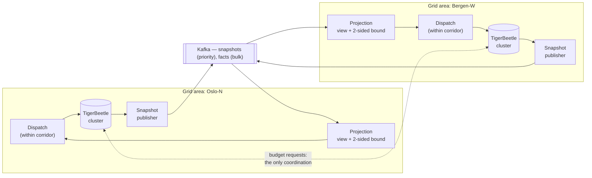

# The Safe Corridor

**Local autonomy inside two-sided limits — bounded-error coordination for distributed energy flexibility.**

Oct 13, 2026 · @Dumitru-Nicolae Marasoiu

## Orientation

**The problem in one sentence:** keep many grid areas dispatching flexible energy assets independently and continuously, while maintaining a portfolio-wide view of delivery whose error is provably bounded on *both* sides at every moment, and coordinating only when a local limit binds.

Both sides matter, and that is the point. Deliver less than committed and the balancing commitment to the transmission operator is broken. Deliver more in one area and the local distribution grid is overloaded. Every site must stay inside a corridor with a floor and a ceiling — hence the name.

This is a personal research and engineering project. It reuses proven primitives (TigerBeetle as the per-site ledger, Kafka as transport) and builds the layer above them: the guarantee layer. The theory is known; the contribution is an open, end-to-end, verified composition applied to a problem that aggregator platforms currently solve privately and informally.

How to read this document:

1. **The domain** introduces Nordic power flexibility from scratch, with the real clocks and real numbers.
2. **Why it is hard** separates the three distinct uncertainties and shows the two invariants live at different scopes.
3. **The generic problem** and **the guarantee** state the model and derive the two-sided bound, with a worked example.
4. **Mechanisms**, **architecture** and **verification** describe how it is built, how it maps onto TigerBeetle, and how each claim can be falsified.
5. **Simplifications**, **prior art** and **phases** keep the scope honest and finishable.

The domain is deliberately simplified. The technical core is where the depth goes.

## 1. The domain: flexibility in the Nordic power system

As electricity replaces fossil fuel and more generation becomes intermittent, the grid needs **flexibility**: consumption, storage and generation that can shift up or down on request. Norway's hydropower has long supplied most of it. Increasingly it must also come from thousands of small distributed resources — heat pumps, EV chargers, home and industrial batteries, flexible industrial loads.

**The business.** An **aggregator** bundles those small resources into a portfolio and sells its flexibility. In market terms it acts as a **Balancing Service Provider (BSP)**. It has two kinds of buyer:

- The **transmission system operator** (Statnett in Norway) buys reserves to keep the whole system in balance. The relevant product here is **mFRR** — manual frequency restoration reserve.
- **Distribution system operators** (Elvia, Glitre Nett and others) buy *local* flexibility to relieve a congested feeder or transformer instead of digging up a street to lay thicker cable.

Those two buyers want opposite things from the same assets, which is the structural source of the two-sided problem.

**Up and down are not what a newcomer expects.** *Up-regulation* means helping the system by increasing net injection — which for a demand asset means **switching it off**. *Down-regulation* means absorbing more, so for a demand asset, **switching it on**. A battery can do either, but only while its state of charge allows: it can inject only above its minimum and absorb only below its maximum. Every asset therefore arrives with a *two-sided* capability envelope that shrinks as it delivers. The corridor is not an abstraction imposed on the domain; it is what the hardware already is.

**The clock is the whole problem.** These are the real timings of the Nordic mFRR energy activation market, automated and running at 15-minute resolution since March 2025:

| Moment | Timing | What is actually known |
| --- | --- | --- |
| Bid submitted | hours ahead | a forecast of capability |
| Activation order arrives | **7.5 min before the period starts** | portfolio state as of now; the central view is already stale |
| Full activation due | **12.5 min after the order** (standard ramp 10 min) | assets responding; telemetry partial and delayed |
| Delivery period | **15 min long** | delivery happening, largely unmeasured |
| Metering settles | **days later** | the measured truth, itself estimated against a baseline |

Read that table twice. **The commitment is made 7.5 minutes before anything physical happens, and the truth arrives days afterwards.** Nothing in this domain lets you decide on fresh, complete information. The only question worth engineering is: *by the end of this period, is delivery provably within a known amount of the commitment?*

**Power versus energy.** A commitment is expressed in **MW** (power, instantaneous). Conservation and settlement work in **MWh** (energy). 5 MW sustained over a 15-minute period is 1.25 MWh. The grid's thermal limit is a power limit; the market's obligation is an energy quantity; the ledger must hold energy. This project keeps its unit of account as **integer watt-hours** and converts at the edges, so no quantity in the ledger is ever a floating-point number.

**The other concepts that matter:**

- **Activation.** The operator orders a committed volume for a given market time unit. Delivery is owed in full within the activation time, then measured and settled per 15-minute period.
- **Baseline.** Flexibility from a demand asset is a *deviation from what would have happened anyway*. The counterfactual cannot be measured, only estimated from metered history by an agreed methodology. So "how much did we deliver" is an **estimate with error bars**, by construction, not by sloppiness.
- **BRP and perimeter correction.** The **Balance Responsible Party** carries financial responsibility for a customer's imbalance. When an *independent* aggregator activates flexibility at a customer whose supplier is a different BRP, the operator applies an ex-post **perimeter correction**: it moves the metered activated volume off the supplier's imbalance position and onto the aggregator's. One debit, one credit, same unit, must sum to zero.
- **Aggregation thresholds.** Small resources only qualify when bundled. Norway's mFRR minimum bid has been 5 MW in price area NO1 and 10 MW elsewhere, falling to 1 MW. That threshold is precisely why aggregators exist.
- **Grid limits are local and invisible from above.** Activating flexibility for system balance must not overload a distribution feeder. The transmission operator cannot see those feeders. The limit must therefore be respected **at the edge, locally, without asking**.
- **Rebound (snapback, the energy payback effect).** A heat pump held off for 15 minutes must catch up afterwards. The deferred load returns as a spike in a *later* period — on the same feeder that was just relieved.

## 2. Why this is hard in an interesting way

### Three uncertainties, not one

Most writing on this problem treats uncertainty as a single quantity. It is three, with different shapes, and the guarantee must absorb all three:

| Source | What is unknown | Can it be bounded by design? |
| --- | --- | --- |
| **Distribution** | what other grid areas have committed since their last snapshot reached me | **Yes** — this is what budgets bound |
| **Measurement** | the true deviation against an unmeasurable baseline, with delayed and missing telemetry | Only by assumption: a worst-case error per site, or a confidence interval |
| **Physics** | the car unplugged, the house was already warm, the asset dropped out | Partly — as capability derating and dropout rates |

### The ledger is a claim, not the truth

This is the sharpest difference from financial ledgers, and the reason this domain is worth the effort. In a payment system the ledger **is** the truth: a committed debit happened, definitionally. Here, a committed dispatch fact is a **claim about the physical world**, confirmed or refuted days later by metering.

So the bound cannot be an interval around an exact centre. It must be an interval around a **noisy** centre, and the noise must be accounted for explicitly rather than hidden in a tolerance. That turns out to have a concrete engineering consequence, derived in §4: measurement error consumes the same scarce resource as local autonomy, so **better metering literally buys more autonomy**.

### The two invariants live at different scopes

| | **Floor** — deliver at least | **Ceiling** — deliver at most |
| --- | --- | --- |
| **Global** (portfolio vs. operator) | **BINDS.** Sum of all areas' delivery ≥ activated volume. Under-delivery breaks the commitment: penalties, and eventually loss of prequalification. | Weak. Over-delivery is unpaid and creates an imbalance position someone must settle. |
| **Local** (one grid area / feeder) | Weak. Reverse-flow and minimum-import limits exist, and matter more as rooftop solar grows. | **BINDS.** This area's swing ≤ the feeder's thermal limit. A cluster of assets moving together overloads the local grid — and the rebound lands here too. |

The two binding constraints sit at **different scopes**, and that asymmetry shapes the entire design:

- The **floor is global**, so checking it requires knowing what every other area is doing — the bounded-error view exists for exactly this.
- The **ceiling is local**, so it can be checked at the edge with **zero coordination**, during a total network partition, at full speed.

Coordination is therefore needed in exactly one situation: *a site hits its local ceiling, and the global floor needs the shortfall picked up elsewhere.* Everything else is local.

### Why availability is revenue, and why the deadline beats speed

Halting an area because the central platform is unreachable means failing to deliver an activation that was already sold — a direct penalty plus reputational damage with the operator. An area that keeps dispatching safely inside known limits keeps the contract.

And the clock is a **deadline**, not a latency budget. Converging fast but unpredictably is useless at 12.5 minutes past the order. A predictable bound is the only thing an operator, or a regulator, can act on.

## 3. The generic problem

Five ingredients. Everything else is built from them.

1. **Sites.** A small number of grid areas or edge controllers (for example Oslo-N, Bergen-W, Trondheim-S). Each is internally strongly consistent and durable. Between sites, links can be slow or partitioned.
2. **Logs.** Each site has an append-only log of committed facts — dispatch decisions, observed responses, metering corrections. Position in the log is an **offset**. Facts are never edited; corrections are new facts.
3. **Quantities.** Values derived from the logs: the net deviation from baseline, in watt-hours, for a given period and a given scope. A quantity's true value is the sum of all committed facts across all sites.
4. **Corridors and budgets.** Each quantity has a corridor `[floor, ceiling]`. Each site holds **two** budgets per quantity: a **down-budget** `D` (how far it may push the quantity below the view without asking) and an **up-budget** `U` (how far above). Budgets move between sites.
5. **Invariants.** The corridor must never be left — globally for the commitment, locally for each feeder.

### There are no unconditionally safe operations

This is where the energy version genuinely diverges from the financial one, not merely in labelling. In a payment system, incoming credits are *safe*: they commute, they can only move a balance further from a floor, and they need no coordination. Classify once as safe or unsafe, and most traffic needs nothing.

Here, **nothing is unconditionally safe**, because help in one direction is harm in the other. Every deviation consumes slack on exactly one side:

| Operation | Down-budget | Up-budget |
| --- | --- | --- |
| Delivering more than planned (an asset over-responds) | frees | **consumes** |
| Delivering less than planned (an asset drops out) | **consumes** | frees |
| Returning unused budget to the pool | — | — |
| Accepting budget from another site | grows | grows |

The safe/unsafe boolean becomes a **two-component vector**. An operation proceeds locally if and only if it fits inside this site's own granted interval **and** inside its local feeder bound. Otherwise it coordinates — pairwise, with whichever site holds spare slack on the side needed.

Each site also keeps a **portfolio view**: its best knowledge of every quantity, assembled from other sites' published state. The question this project answers is how far that view can be from the truth, on each side, and how to guarantee it never drifts further.

## 4. The guarantee

> **The portfolio view is exact up to each site's last snapshot. Below the truth by at most the sum of the sites' down-budgets, and above it by at most the sum of their up-budgets — plus, on both sides, each site's own measurement error.**

Each site periodically publishes a snapshot: *"up to offset N, my cumulative contribution to quantity q is C."* A receiver keeps only the highest-offset snapshot per site and sums them. Writing `C_s(q, t)` for site `s`'s cumulative contribution as of time `t`, and `N_s` for its last published offset:

$$\text{true}(q) = \sum_{s} C_s(q,\ \text{now})
\qquad
\text{view}(q) = \sum_{s} C_s(q,\ N_s)$$

The error is entirely what each site committed after its last snapshot, $\delta_s = C_s(q,\text{now}) - C_s(q,N_s)$. The budget contract is exactly the statement that this is two-sidedly bounded:

$$-D_s \;\le\; \delta_s \;\le\; U_s
\qquad\Longrightarrow\qquad
\text{view}(q) - \sum_s D_s \;\le\; \text{true}(q) \;\le\; \text{view}(q) + \sum_s U_s$$

The corridor `[F, C]` is provably respected when the whole interval sits inside it:

$$F + \sum_s D_s \;\le\; \text{view}(q) \;\le\; C - \sum_s U_s$$

### The corollary that makes this a real problem

Those two conditions can only be satisfied at once if

$$\boxed{\ \sum_s \left(D_s + U_s\right) \;\le\; C - F\ }$$

**The total autonomy that may ever be handed out is capped by the width of the safe corridor.** This is the structural fact that a one-sided, financial version of the problem cannot have. Without a ceiling, `C` is infinite, budget is limited only by distance to the floor, and handing it out is nearly free. With both limits, the two directions compete for one scarce, fixed resource, and dividing it among sites is a genuine allocation problem with a hard feasibility constraint — enforced on the allocator, not hoped for.

### Folding in measurement error

Each site's own figure `C_s` is an estimate: the baseline is a counterfactual and telemetry is incomplete. Let `ε_s` bound site `s`'s own error. Then

$$\text{view}(q) - \sum_s \left(D_s + \varepsilon_s\right) \;\le\; \text{true}(q) \;\le\; \text{view}(q) + \sum_s \left(U_s + \varepsilon_s\right)
\qquad\text{and}\qquad
\sum_s \left(D_s + U_s + 2\varepsilon_s\right) \le C - F$$

Measurement error consumes corridor on **both** sides, and it consumes the same budget that local autonomy needs. So a concrete, quotable consequence: **sub-metering is not a reporting improvement, it is a purchase of operational autonomy.** Halve `ε`, and the freed corridor can be handed straight back to the edge as budget.

### Worked example

A portfolio commits **5 MW up-regulation** for one 15-minute period: **1,250 kWh** owed. Over-delivery beyond +10% is treated as a ceiling (a stated simplification, see §8), so the corridor is **[1,250, 1,375] kWh** — width **125 kWh**. Measurement error is ignored here for clarity.

| Grid area | Last snapshot offset | Delivery at snapshot | Down-budget `D` | Up-budget `U` | Local feeder headroom |
| --- | --- | --- | --- | --- | --- |
| Oslo-N | 4,210 | 520 kWh | 20 | 25 | 600 kWh |
| Bergen-W | 3,880 | 410 kWh | 25 | 20 | 480 kWh |
| Trondheim-S | 2,975 | 365 kWh | 15 | 15 | 400 kWh |
| **Portfolio** | | **1,295 kWh** | **60** | **60** | |

The view is 1,295 kWh, so the truth is guaranteed to lie in **[1,235, 1,355] kWh**.

- **Ceiling side: provably safe.** 1,355 ≤ 1,375. No action needed.
- **Floor side: not provably safe.** 1,235 < 1,250. The commitment *might* already be breached and nobody would know.
- **Feasibility: tight.** Budget handed out is 120 kWh against a corridor of 125. Legal, but there is 5 kWh of headroom in the whole scheme.
- **Local ceilings: safe without coordination.** Oslo-N can reach at most 520 + 25 = 545 ≤ 600. Each area verifies this alone, even fully partitioned.

The system has three levers, and picks by cost:

1. **Request fresh snapshots** — collapses the `δ`s toward zero. Cheapest, but needs the network.
2. **Shrink down-budgets** — trade autonomy for knowledge. Recalling 15 kWh of `D` from Trondheim-S gives a lower end of exactly 1,250 kWh: **provably safe**, with `Σ(D+U)` now 105 ≤ 125.
3. **Dispatch more** — raise the view itself, if capability remains.

This is why budgets carry two jobs at once: they **permit local action** and they **bound global error**. Shrinking them buys certainty with autonomy. The corollary above says how much of either you can ever afford.

## 5. Core mechanisms

**1. Snapshots keyed by offset, not by time.** A snapshot says "everything up to offset N", which is deterministic — no clocks needed to define a batch, which matters when nothing in this domain has a trustworthy shared clock. A receiver keeps the highest offset per site and discards the rest. Duplicates and reordering change nothing: the merge is a max-register, one of the simplest CRDTs. Batch idempotency stops being a problem to solve.

**2. Two-sided escrow.** Each site holds a down-budget and an up-budget per quantity, and approves dispatch locally while both hold. When one side runs short it requests from a site with spare slack on that side: pairwise coordination, only when needed, never global consensus. The allocator enforces `Σ(D+U+2ε) ≤ C − F` as a hard invariant. Allocation policy is the main open design space.

**3. Selective coordination.** Classification is the two-vector of §3. Only operations that would leave a site's granted interval touch coordination. A site's local feeder ceiling never does.

**4. Exactly-once projection.** The projection commits its derived state and the vector of source offsets in one atomic write, and resumes from the stored vector on restart. That offset vector is also a version vector: exactly-once delivery and causal tracking are the same structure.

**5. Conservation across space *and time*.** Money can sit in transit between places; energy cannot. But energy moves in **time**. A heat pump held off for one period must catch up in the next, and that deferred load is a **liability in a future period's account**: the delivery fact for period P is matched by a credit to `deferred_load(P+1)`, drawn down as the load returns. Conservation then holds across a *sequence* of periods rather than within one — and the ledger makes the rebound visible **before it arrives**, which is exactly what the local ceiling needs, because the snapback lands on the same feeder that was just relieved. The in-transit mechanism generalises from space to time.

**6. Priority by magnitude.** A large deviation triggers an immediate snapshot, so big moves become visible in seconds while small ones ride the regular interval. Priority affects visibility latency; the bound itself comes from budgets, so correctness never depends on the fast path working.

**7. Two kinds of replay.** *Semantic* replay rebuilds state from any order of facts consistent with causality. *Execution* replay reproduces one site's actual apply order from a recorded list of fact IDs. Comparing many random valid orders tests whether operations assumed to commute actually do.

## 6. Architecture

**Each site's ledger decides alone inside its corridor; snapshots cross between sites; each projection keeps a portfolio view with a guaranteed two-sided bound.**

Assets, meters and the market interface sit outside this picture: activations arrive as facts, and metering arrives later as corrections.

| Component | Role | Technology |
| --- | --- | --- |
| Ledger | System of record per site; decides and commits within the corridor | TigerBeetle (simulated in early phases) |
| Snapshot publisher | Turns committed facts into offset-keyed cumulative totals | Project code, fed by TigerBeetle change data capture |
| Transport | Carries snapshots (priority) and facts (bulk) between sites | Kafka (simulated in early phases) |
| Projection | Portfolio view, two-sided bound, exactly-once state | Project code |
| Budget allocator | Splits the corridor across sites; enforces the feasibility invariant | Project code |
| Simulator | Deterministic time, faults, metering noise, invariant checks | Project code on Cats Effect |

The project's own code is the guarantee layer: publisher, projection, allocator, simulator. Ledger and transport are reused, not rebuilt.

### Why one TigerBeetle cluster *per site*

A TigerBeetle cluster is strictly consistent, replicated by Viewstamped Replication, and intended to sit within one failure domain. That is a feature here, not a limitation: it is precisely why each site gets its own cluster and the escrow layer sits **above** them. Trying to stretch one strongly consistent cluster across grid areas would reintroduce exactly the coordination this project exists to avoid, and would make an unreachable peer into a halted dispatcher.

### Does energy accounting actually fit a financial ledger?

Yes — and in one respect better than finance does, because **conservation here is a physical law rather than a bookkeeping convention**. Every watt-hour delivered genuinely came from somewhere. Losses and round-trip inefficiency become an explicit expense account, which is how double entry already handles them, and conservation then holds exactly. The industry also already does double entry without naming it: the **perimeter correction** is one debit and one credit in the same unit, summing to zero.

| Domain concept | TigerBeetle construct |
| --- | --- |
| Unit of account | `ledger` = integer watt-hours; `amount` as u128, asset scale fixed at cluster design time |
| A party's position for one period | An account keyed `(entity, period)`; `user_data_64` carries the period, `user_data_32` the grid area |
| What kind of party or movement | `code` — BSP, BRP, grid area, asset group, losses, deferred load |
| Delivery committed by a site | Transfer: debit the asset group, credit the portfolio delivery account |
| Perimeter / BRP correction | Transfer: debit the aggregator, credit the affected BRP's imbalance account — same unit, sums to zero |
| Losses and conversion efficiency | Transfer into a `losses` account; conservation then holds exactly |
| Dispatched but not yet metered | Two-phase pending transfer with `timeout` set to the period deadline; auto-voids if never confirmed |
| "Give what you can, up to N" | `flags.balancing_debit` / `flags.balancing_credit` — dispatch what the asset actually has without failing the batch |
| A floor on a position | `flags.debits_must_not_exceed_credits` (or its mirror) |
| **A two-sided corridor** | The documented *Balance Bounds* recipe: the target account, a **control account carrying the opposite flag**, an operator account to fund it, and five **linked** transfers that all succeed or all fail |
| Down-budget and up-budget | More naturally, each slack side as its **own** one-sided account: consuming budget is a transfer out of it, so **a two-sided bound on a quantity is two one-sided bounds on its slacks** |
| Energy settled into money | A linked transfer pair across the watt-hour and currency `ledger`s — the documented FX pattern |
| Correction after metering arrives | A new transfer. Never an amendment, which matches how settlement actually works |

**Where TigerBeetle stops, stated plainly.** It cannot express **time-coupling**: ramp rates, state-of-charge trajectories, thermal dynamics. Those belong to the dispatch layer above it; the ledger records what was decided and what was observed. Amounts are integers, so efficiency ratios are applied by the caller before the transfer. And energy at 14:00 is a different commodity from energy at 14:15 — different price, different obligation — so a position is keyed per period rather than carried on a timestamp. Accounts are cheap enough for that to be the natural modelling choice.

## 7. Verification

Correctness is established by **deterministic simulation**: every failure scenario is generated from a seed and replays exactly. The simulator controls time, message delivery, partitions, crashes, reordering, asset dropout and metering noise as effects. A failing seed reproduces the same run every time, turning rare distributed bugs into ordinary debuggable ones. This is the approach FoundationDB and TigerBeetle themselves use.

Each claim below is stated so that it can fail:

| Claim | Falsified by | Check |
| --- | --- | --- |
| The truth never leaves `[view − Σ(D+ε), view + Σ(U+ε)]` | any simulated run where it does | asserted after every step, across all seeds |
| `Σ(D + U + 2ε) ≤ C − F` holds at all times | a grant that overcommits the corridor | invariant on the budget allocator |
| No feeder limit is breached, whatever the central view says | a partition in which two areas both swing up | partition plus concurrent-dispatch scenarios |
| Whenever the bound reports *provably safe*, delivery does meet the commitment | a provably-safe period that under-delivers | compare the bound's verdict against simulated ground truth |
| Energy is conserved across periods, rebound included | total in ≠ total out + losses + deferred | conservation check over a window of periods |
| Exactly-once | a fact applied twice, or a committed fact lost | crash and restart at every step |
| Convergence | views still disagree after healing and quiescing | heal, quiesce, compare all views to the truth |
| Order independence | two valid causal orders yield different state | property test over many random valid orders |

The last one is the sharpest: a difference reveals an operation wrongly assumed to commute, which is the failure mode this whole class of design is most prone to.

## 8. Explicit simplifications

This is a model of the domain, not a trading or dispatch platform. These are deliberate and stated up front:

| Area | Real world | This project |
| --- | --- | --- |
| Market design | Bidding, pricing, prequalification, MARI platform integration | Out of scope; activations arrive as facts with a volume, a period and a deadline |
| The ceiling | Over-delivery is settled through imbalance pricing, not forbidden | A fixed tolerance band above the commitment, treated as a hard ceiling |
| Baseline | An agreed, contested, asset-class-specific methodology | A simulated baseline with configurable error `ε` |
| Metering | Smart meters, a national data hub, hourly-to-15-min granularity, late and missing values | Simulated metering with configurable delay, loss and bias |
| Physical assets | Response curves, ramp rates, state of charge, thermal dynamics | A capability interval per asset per period, plus a dropout probability |
| Grid model | Power flow, voltage, phase imbalance, nodal topology | One energy ceiling per area, as a thermal proxy |
| Rebound | Asset-specific payback curves | A fixed fraction deferred to the next period |
| Settlement and money | Imbalance pricing, BSP/BRP contracts, remuneration | Volumes only; money appears as a second `ledger`, with no pricing |
| Regulation | Prequalification, reporting, licences | Out of scope |

No confidential information from any employer is used. All concepts come from public material and general knowledge.

## 9. Prior art and positioning

**Not new theory, but an open, end-to-end, verified composition of known theory — extended to the two-sided case, which is where the interesting constraint appears.**

The computer science lineage comes from databases and, in practice, from telecom prepaid charging, where granting a network node a local quota slice so it can serve a call without consulting the centre has been routine for decades. All of it is one-sided.

| Work | Year | What it contributes here |
| --- | --- | --- |
| O'Neil, *The Escrow Transactional Method* | 1986 | The original escrow idea |
| Barbará & Garcia-Molina, Demarcation protocol | 1992 | Local action within distributed limits — the direct ancestor of the corridor |
| Yu & Vahdat, TACT | 2000 | Consistency with explicit numerical error bounds; closest prior art to the guarantee |
| Shapiro et al., CRDTs | 2011 | Convergent merge, including the max-register used for snapshots |
| Thomson & Abadi, Calvin | 2012 | Deterministic ordering in epochs; explicit absence via empty batches |
| Bailis et al., Coordination Avoidance | 2014 | Invariant confluence: which operations need coordination at all |
| Liu et al., *Warranties for Faster Strong Consistency* | 2014 | Time-limited assertions permitting local action |
| Roy et al., The Homeostasis Protocol | 2015 | Automatically deriving local conditions from a global invariant |
| Balegas et al., bounded counters / Indigo | 2015 | Escrow-style numeric invariants on eventually consistent stores |

On the domain side: the EU Electricity Balancing Guideline (Reg. 2017/2195) and Electricity Directive 2019/944 Art. 17 establish the independent-aggregator and correction mechanisms; the Nordic Balancing Model's mFRR energy activation market implementation guides give the actual timings and message flows; USEF's flexibility framework covers baselines and aggregator models; OpenADR and IEEE 2030.5 cover device-level dispatch; NODES and the Euroflex programme are live Norwegian local-flexibility marketplaces.

Aggregator and virtual-power-plant platforms clearly solve some version of this problem today. From public material, they do not publish a formal error bound under partition, and the two-sided case — where local autonomy and measurement error compete for a fixed corridor — does not appear to be treated explicitly anywhere. This project makes those guarantees explicit and testable.

## 10. Phases

**First milestone: three simulated grid areas, each with its own log of committed deviations, projected exactly-once into a portfolio view that reports a *two-sided* error bound at every moment, with local feeder ceilings never breached under partition.**

The milestone is done when a simulation partitions and heals the sites and shows that energy is conserved, no feeder ceiling is breached, and the reported two-sided bound is never violated.

1. **Single-site ledger and projection.** Immutable deviation facts, idempotency by fact ID, derived position per `(area, period)`, atomic state-plus-offset commit.
2. **Three sites, snapshots, simulator — and the two-sided bound computed live** *(the milestone)*. Offset-keyed snapshots, max-register merge, deterministic simulation with the invariant checks.
3. **Two-sided escrow.** Down- and up-budgets per site, local approval inside the interval, pairwise requests, and the corridor-width feasibility invariant enforced on the allocator.
4. **Measurement uncertainty.** Baseline error and telemetry gaps as `ε_s` folded into the bound; late-arriving metering as corrections that re-derive history.
5. **Time coupling.** Deferred-load liabilities, rebound into the following period, conservation checked across a window.
6. **Allocation policy and partition behaviour.** Where corridor should live, proactive versus on-demand reallocation, and what a site does when it hits a limit mid-partition.
7. **Real primitives.** TigerBeetle per site via change data capture; Kafka as transport.
8. **Baseline comparison.** A strongly consistent central-dispatch design, measured against the corridor design for availability and delivery compliance under partition.

## 11. Open questions and reading

**The central research question.** Should `ε` be a **hard worst-case bound** or a **confidence interval**? The floor is a hard contractual commitment, but the measurement against it is irreducibly statistical. A worst-case `ε` keeps the guarantee absolute and may consume so much corridor that no autonomy is left; a probabilistic `ε` is far tighter but weakens the claim from *provably safe* to *safe with probability p*. This tension is specific to the energy domain — a financial ledger never has it — and resolving it honestly is the most interesting part of the project.

Other open questions:

- [ ] How should the corridor be allocated: proportional to each area's forecast capability, to its observed dropout rate, or solved as an optimisation each period?
- [ ] Does the local feeder ceiling belong in the same quantity as the global commitment, or is it a separate quantity with its own corridor and its own budgets?
- [ ] Should rebound be booked as a liability at dispatch time (pessimistic but predictable) or recognised when observed (accurate but too late to protect the feeder)?
- [ ] Is a market period an account or a `ledger` in TigerBeetle? Accounts are cheap; ledgers isolate; the choice constrains which cross-period queries are possible.
- [ ] Does TigerBeetle's change data capture expose enough to build offset-keyed snapshots, or must the publisher derive its own offsets?
- [ ] How should two-phase transfers be ordered in the projection when priority and bulk traffic travel different paths?

*Decided, so no longer open:* **Cats Effect**, for its `TestControl`, which executes an entire program under fully deterministic simulated time. ZIO's `TestClock` would serve equally well; the choice is not load-bearing.

Reading list, in suggested order:

1. Yu & Vahdat, *Design and Evaluation of a Conit-Based Continuous Consistency Model for Replicated Services* (TACT), 2000.
2. Bailis et al., *Coordination Avoidance in Database Systems*, 2014.
3. Roy et al., *The Homeostasis Protocol: Avoiding Transaction Coordination Through Program Analysis*, 2015.
4. Balegas et al., *Putting Consistency Back into Eventual Consistency* (Indigo), 2015, and the bounded-counter paper.
5. O'Neil, *The Escrow Transactional Method*, 1986, and Barbará & Garcia-Molina, *The Demarcation Protocol*, 1992.
6. Nordic Balancing Model, [mFRR energy activation market — BSP implementation guide](https://nordicbalancingmodel.net/tag/mfrr-energy-activation-market/).
7. Statnett, [*Opportunities for aggregated flexibility in Norway — a TSO perspective*](https://www.nve.no/media/11777/statnett-2021-03-08-opportunities-for-aggregated-flexibilty-in-norway-a-tso-perspective.pdf).
8. TigerBeetle, [Balance Bounds recipe](https://docs.tigerbeetle.com/coding/recipes/balance-bounds/) and [Change Data Capture](https://docs.tigerbeetle.com/operating/cdc/).
